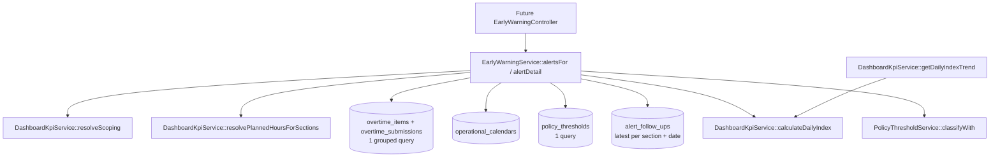
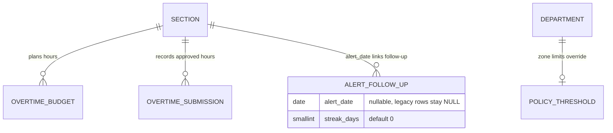

# Early Warning Alert Detection (E10-01)

## Overview

`EarlyWarningService` derives Early Warning alerts automatically from the daily burn index. One alert is **one section on one date** whose daily index is in zone **Kuning** or **Merah** (never Hijau). Each alert carries its consecutive-working-day **streak**, the department's zone limits, and the status of the latest 5W2H follow-up. This story is backend-only: the sidebar menu, inbox and detail pages are delivered by E10-02 to E10-04, and the 5W2H save/send flow by E10-06 ([Early Warning Follow-Up](./early-warning-follow-up.md)).

The daily index formula is **shared** with the Dashboard Early Warning chart (`DashboardKpiService::getDailyIndexTrend`) so the chart and the alerts can never disagree.

## Architecture Diagram

## Data Model

Migration `2026_10_14_220807_add_alert_date_and_streak_days_to_alert_follow_ups_table` adds `alert_date`, `streak_days` and the index `idx_alert_follow_ups_section_alert_date (section_id, alert_date)`. Alerts themselves are **not stored**: they are recomputed on demand.

## Key Files & UI Mapping

| Layer             | File / Route / Menu                                                                                | Purpose                                                                                   |
| ----------------- | -------------------------------------------------------------------------------------------------- | ----------------------------------------------------------------------------------------- |
| Sidebar Menu      | _Early Warning_ (E10-02, see [Menu, Routes & Authorization](./early-warning-navigation-access.md)) | Entry point and open-Merah badge                                                          |
| Service           | `app/Services/EarlyWarningService.php`                                                             | `alertsFor()`, `alertDetail()`, `isAlert()`                                               |
| Shared calculator | `app/Services/Analytics/DashboardKpiService.php`                                                   | `calculateDailyIndex()`, `calculateDailyPacing()`, `resolvePlannedHoursForSections()`     |
| Zone limits       | `app/Services/PolicyThresholdService.php`                                                          | `classifyWith()` with the section department's threshold                                  |
| Model / Factory   | `app/Models/AlertFollowUp.php`, `database/factories/AlertFollowUpFactory.php` (`forAlert()`)       | Follow-up linked to an alert                                                              |
| Tests             | `tests/Feature/EarlyWarningServiceTest.php`                                                        | 20 tests (classification, streak, scope, ordering, follow-up status, query count, detail) |

## Flow Explanation

1. **Scope** — `alertsFor()` rejects roles other than admin / manager / team leader. For non-admins the department is forced to the user's own department through `resolveScoping()`; the department/section the client sends is never trusted. A non-admin without a department gets nothing.
2. **Window** — dates are Asia/Jakarta calendar dates; days after today are ignored. The scan starts `STREAK_LOOKBACK_DAYS` (60) before the range so a streak that began earlier is counted.
3. **Constant-query data load** — sections (+ department), planned hours (budget, then monthly burn snapshot as fallback), approved hours grouped by `section_id` + `operational_date`, calendar day types, policy thresholds and follow-ups: a fixed number of queries regardless of sections or days.
4. **Per day evaluation** — `index = calculateDailyIndex(approvedHours, plannedHours / daysInMonth)`; `zone = classifyWith(index, departmentThreshold)`.
5. **Streak** — walking forward through days: a working day (HKN) that is Kuning/Merah increments the streak, a Hijau working day resets it, HLR days are skipped. An HLR alert day counts itself (`streak + 1`) but does not extend the working-day streak. A working day in a month without budget resets the streak.
6. **Result** — alerts sorted Merah first, then `streak_days` desc, then `alert_date` desc, then section name.

### Alert shape

| Key                                | Type                      | Notes                                      |
| ---------------------------------- | ------------------------- | ------------------------------------------ |
| `section_id`, `section_name`       | int, string               |                                            |
| `department_id`, `department_name` | int, string/null          |                                            |
| `alert_date`                       | `Y-m-d`                   | Asia/Jakarta                               |
| `index_pct`                        | float                     | 1 decimal, same as the Dashboard chart     |
| `zone`                             | `yellow` \| `red`         | `BurnZone` value                           |
| `streak_days`                      | int                       | Consecutive working days, minimum 1        |
| `green_max_pct`, `yellow_max_pct`  | float                     | Effective department limits                |
| `follow_up_status`, `follow_up_id` | `none\|draft\|sent`, ?int | Latest follow-up (highest id) for the date |

`alertDetail()` returns `alert` (null when the date is Hijau, has no budget, or is in the future), `series` (the last 7 working days up to the date; the date itself is always included, even on HLR) and the zone limits.

## Decisions & Trade-offs

- **Shared primitives, not a shared loop.** The Dashboard chart aggregates a department or the plant, while alerts need one value per section. The shared pieces are the formula (`calculateDailyIndex`), the pacing (`calculateDailyPacing`) and the planned-hours rule (`resolvePlannedHoursForSections` mirrors `resolvePlannedHours`, including the 1-decimal rounding). A parity test compares alerts against `getDailyIndexTrend` for the same section.
- **Streak lookback cap.** To keep the query count constant, history is scanned 60 calendar days before the range instead of "until the first Hijau day". Longer streaks are capped at what that window shows.
- **No budget means no alert.** The Dashboard shows 0 % or 100 % for a scope without budget; for alerts this would be a false Hijau/Merah, so those days are skipped and break the streak.
- **Department-level scope for non-admins**, as written in the epic (D3), also for Team Leaders (the Dashboard narrows a Team Leader to their section; the inbox does not).
- **Date range comparisons** use `>= 'Y-m-d'` and `<= 'Y-m-d 23:59:59'` so both SQLite (`datetime` cast storage) and MySQL (`DATE`) match the end day while keeping the columns index-friendly.

## Related

- [Epic-10](../../scrum/Epic-10.md) — Early Warning & Alert Follow-Up
- [Executive Dashboard Multi-Chart Analytics Grid](./executive-dashboard-multi-chart-grid.md) — the Early Warning chart (E09-04)
- [Policy Threshold Configuration](./policy-threshold-configuration.md) — zone limits
- [Operational Calendar Management](./operational-calendar-management.md) — HKN / HLR day types
- [ADR-040](../decisions/040-early-warning-alert-detection-shared-daily-index.md)
