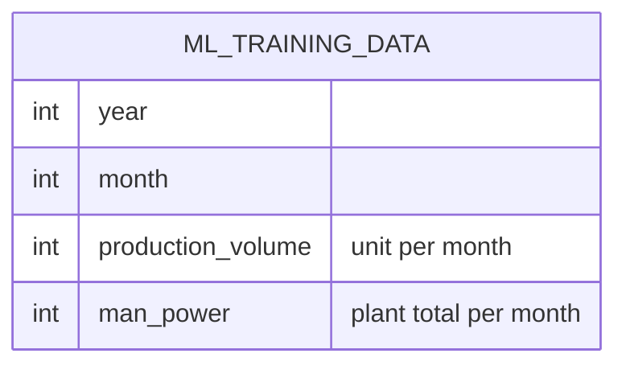

# Early Warning Alert Vitals (E10-05)

## Overview

E10-05 gives the two vitals cards of the alert detail page their real data: **production volume change** and **manpower change**. `EarlyWarningService::vitalsFor(Section, date)` compares the alert month with the previous month in `ml_training_data` and returns the percentage plus a period label ("vs September 2026"). When a number cannot be computed honestly (a month is missing, or the previous value is 0) it returns `null` with no label, and the page shows `N/A` with a tooltip. The service never defaults to a dummy value. When a month has no actual row, the planned figure of `ml_forecast_inputs` (Forecasting page) is used instead and `volume_source` / `manpower_source` is `forecast` (else `actual`, or `null` for N/A); the card then shows an amber dashed border and an amber **Forecast** badge with a tooltip, and the 5W2H "Why" appends "forecast data". An actual row always wins over a forecast row. The vitals are also the input the 5W2H generator (E10-08) will read; this story writes no "Why" text.

## Architecture Diagram

```mermaid
flowchart TD
    S[EarlyWarningController@show] -->|authorized section + alert date| V[EarlyWarningService::vitalsFor]
    V -->|one query: alert month + previous month| M[(ml_training_data)]
    V -->|fallback when a month has no actual row| F[(ml_forecast_inputs)]
    M --> P[percentChange: round 1 decimal, null if missing or previous <= 0]
    F --> P
    P --> L[monthLabel in active locale]
    L -->|vitals prop| G[AlertVitalsGrid.vue]
    G -->|value| C[trend arrow + signed %]
    G -->|null| N[N/A + tooltip]
    V -.->|E10-08| GEN[EarlyWarningFollowUpGenerator]
```

## Data Model

No schema change. Source table (existing):



`(year, month)` is unique, so the alert month and the previous month are at most two rows.

Prop `vitals` of `early-warning/Show` (shape unchanged since E10-04):

| Key                     | Type             | Meaning                                                                 |
| ----------------------- | ---------------- | ----------------------------------------------------------------------- |
| `volume_change_pct`     | `float \| null`  | `(volume − previous volume) / previous volume × 100`, 1 decimal         |
| `volume_period_label`   | `string \| null` | `vs September 2026` (locale `en`) / `vs September 2026` (`id`)          |
| `manpower_change_pct`   | `float \| null`  | Same formula on `man_power` (plant-wide)                                |
| `manpower_period_label` | `string \| null` | `vs September 2026 (plant-wide)` / `vs September 2026 (seluruh pabrik)` |

## Key Files & UI Mapping

| Layer          | File / Route / Menu                                                                 | Purpose                                                                             |
| -------------- | ----------------------------------------------------------------------------------- | ----------------------------------------------------------------------------------- |
| Sidebar Menu   | _Early Warning_ → open an alert                                                     | The cards sit under the burn bar of the alert detail (no new item or route)         |
| Page Component | `resources/js/pages/early-warning/Show.vue`                                         | Unchanged; already passes `vitals` to the grid                                      |
| Component      | `resources/js/components/early-warning/AlertVitalsGrid.vue`                         | Unchanged; shows the value, trend arrow, period label, or `N/A` + tooltip           |
| Controller     | `app/Http/Controllers/EarlyWarningController.php` (`show`)                          | Replaces the `null` placeholder with `vitalsFor()` after the policy check           |
| Service        | `app/Services/EarlyWarningService.php` (`vitalsFor`, `percentChange`, `monthLabel`) | Reads `MlTrainingData`, computes the change and the label                           |
| Model          | `app/Models/MlTrainingData.php`                                                     | Monthly volume and man power                                                        |
| i18n           | `lang/id.json`, `lang/en.json`                                                      | `vs :period`, `vs :period (plant-wide)` (kept in sync, sorted)                      |
| Tests          | `tests/Feature/EarlyWarningVitalsTest.php`                                          | 11 tests: both sources, decrease, rounding, missing, zero, partial, January, locale |
| Tests          | `tests/Feature/EarlyWarningDetailTest.php`                                          | `vitals` prop with and without data                                                 |
| Browser tests  | `tests/Browser/EarlyWarning/EarlyWarningDetailBrowserTest.php`                      | Real value + period + trend arrow, and `N/A` without a period label                 |

## Flow Explanation

1. **User triggers** — opens an alert from the **Early Warning** inbox.
2. **Request handling** — `EarlyWarningController@show` authorizes the section first (another department = 403), then validates the date.
3. **Business logic** — `vitalsFor()` takes the first day of the alert month and of the previous month (`subMonthNoOverflow`, so 31 Oct → September and January → December of the year before). One query loads both rows. `percentChange()` returns `null` when either value is missing or the previous value is `<= 0`, otherwise the rounded change. The label is built only when a number exists.
4. **Response** — the grid shows `+20%` with an up arrow and "vs September 2026", or `N/A` with the tooltip "Production volume data is not available for this period."

## API Endpoints & Routes

No new route. `vitals` is part of the existing response of `GET /early-warning/{section}/{date}` (`early-warning.show`).

## Decisions & Trade-offs

- **Monthly volume, honestly labelled.** No daily or weekly volume exists (ERP integration pending), so the epic's "+20% in the last 7 days" cannot be computed. The label is the real period, never "7 hari terakhir".
- **Manpower is plant-wide, not per section.** The epic prefers active employees of the section between the alert date and 7 days earlier, but `employees` has no hire or termination date (only `is_active` and `created_at`), so a past head count cannot be rebuilt; using `created_at` would show a false "0%" after a bulk import. The epic's own fallback (monthly `man_power`) is used and the label says "(plant-wide)". See [ADR-044](../decisions/044-early-warning-vitals-monthly-plant-wide-source.md).
- **`$section` is unused for now.** It is in the signature the epic fixes, so a section-level source (employee dates, or daily ERP data) can replace the plant-wide one without changing callers.
- **No user argument.** The controller already authorized the section; the data is monthly plant figures, not a section's confidential data.
- **Not cached.** One indexed query of at most two rows per page view; the sidebar badge is the only cached Early Warning value.
- **Neutral presentation.** An increase is information, not good or bad (E10-04), so no red/green coloring.

## Related

- [Early Warning Alert Detail Page (E10-04)](./early-warning-alert-detail.md)
- [ADR-044](../decisions/044-early-warning-vitals-monthly-plant-wide-source.md)
- [Epic-10](../../scrum/Epic-10.md)
