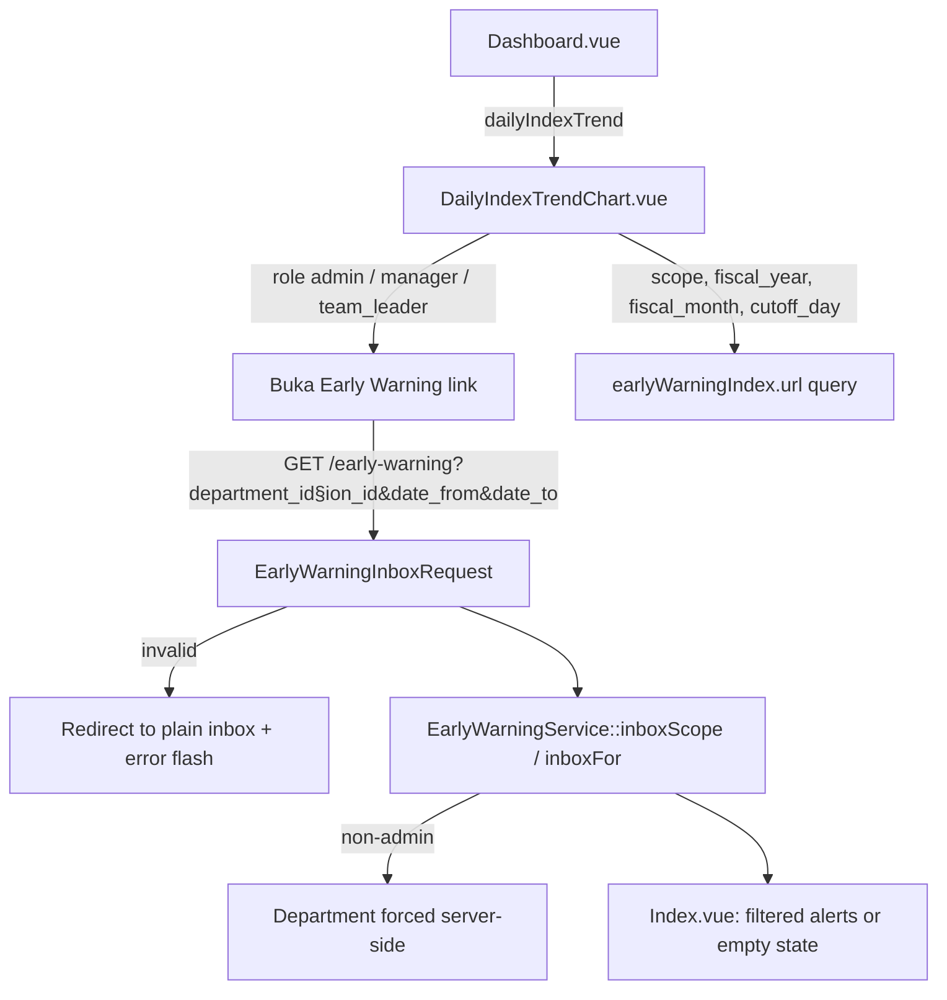
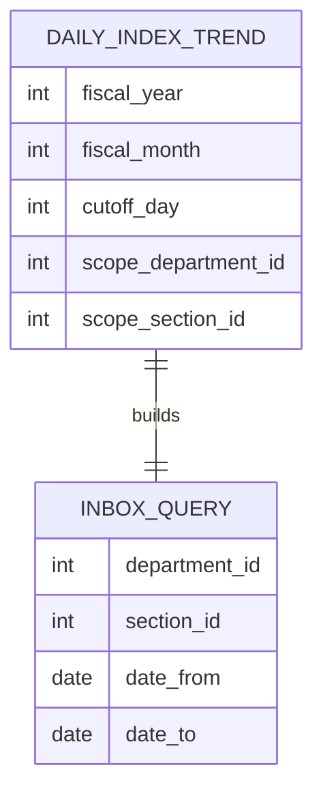

# Early Warning Dashboard Entry Link & Cleanup (E10-07)

## Overview

E10-07 closes the Dashboard side of Epic-10. The **Early Warning** chart (`DailyIndexTrendChart.vue`, Dashboard → tab "Distribution & Trends") stays where it is, and its header now carries a **Buka Early Warning** button. The button opens the Early Warning inbox already filtered with the chart's own scope: its department, its section and the month up to the chart's cut-off day. It is shown only to the roles that can open the module (admin, manager, team leader) and is shown even when the chart is Hijau, in which case the inbox shows its positive empty state. The rest of the cleanup (Dashboard panel, `alertFollowUps` prop, old routes, `DashboardController` loading) was already done by E10-06; this story also removes the two translation keys that only the removed panel used.

## Architecture Diagram

## Data Model

No schema change. The link is built from data the chart already receives.

## Key Files & UI Mapping

| Layer         | File / Route / Menu                                            | Purpose                                                                                                   |
| ------------- | -------------------------------------------------------------- | --------------------------------------------------------------------------------------------------------- |
| Sidebar Menu  | _Dashboard_ → tab **Distribution & Trends** → chart header     | Entry point; the module itself is still reached from _Early Warning_ in the sidebar                       |
| Component     | `resources/js/components/dashboard/DailyIndexTrendChart.vue`   | `canOpenEarlyWarning` (role check), `earlyWarningUrl` (Wayfinder `index.url({ query })`), the link button |
| Route         | `early-warning.index` via `@/routes/early-warning`             | Existing inbox route; no new route or page                                                                |
| Request       | `app/Http/Requests/EarlyWarningInboxRequest.php`               | Unchanged; validates the query (`Y-m-d`, range < 93 days)                                                 |
| i18n          | `lang/id.json`, `lang/en.json`                                 | Added `Buka Early Warning`; removed two keys only the old panel used                                      |
| Browser tests | `tests/Browser/EarlyWarning/DashboardEntryLinkBrowserTest.php` | 3 tests (filters carried, Hijau empty state, team leader scope)                                           |
| Browser tests | `tests/Browser/EarlyWarning/AlertFollowUpBrowserTest.php`      | Unchanged: asserts the Dashboard no longer has `followup-panel` (E10-06)                                  |

## Flow Explanation

1. **User triggers** — a manager, team leader or admin opens the Dashboard, tab **Distribution & Trends**, and clicks **Buka Early Warning** in the Early Warning chart header.
2. **Link building** — `earlyWarningUrl` reads the chart payload: `scope.department_id` and `scope.section_id` become `department_id` / `section_id` when set; when `cutoff_day > 0` the range is the first day of `fiscal_year`/`fiscal_month` up to the cut-off day (`date_from`, `date_to`, `Y-m-d`). With no cut-off (a month in the future) the dates are left out and the inbox default (last 7 days) applies.
3. **Request handling** — a normal Inertia visit of `GET /early-warning`. `EarlyWarningInboxRequest` validates the query; a non-admin's department is forced to their own on the server, so the client value is never trusted.
4. **Response** — the inbox renders with the chart's scope in its filters and the URL (shareable). A Hijau chart simply yields no alerts and the empty state "No alerts in this period".

## API Endpoints & Routes

No new endpoint.

| Method | URI                                                         | Controller Action              | Purpose                               | Auth                                           |
| ------ | ----------------------------------------------------------- | ------------------------------ | ------------------------------------- | ---------------------------------------------- |
| GET    | `/early-warning?department_id&section_id&date_from&date_to` | `EarlyWarningController@index` | Inbox opened from the Dashboard chart | auth, verified, role admin/manager/team_leader |

## Decisions & Trade-offs

- **No new props or backend change.** The chart payload already contains the scope and the month/cut-off, so the link is built on the client from it. The chart stays unchanged otherwise. See [ADR-046](../decisions/046-early-warning-dashboard-entry-link-built-from-chart-scope.md).
- **Range = month to the cut-off day, not the dashboard's single date.** The chart shows the whole month up to the selected date, so the inbox shows the same days. The range is never longer than 31 days, inside the inbox limit of 93.
- **Role check in the component.** The chart is only rendered for dashboard users; the button mirrors the sidebar rule (admin, manager, team leader). Operators would only get a 403, so the button is hidden rather than shown and refused.
- **Button visible on Hijau.** Hiding it would make the entry point disappear exactly when the user wants to confirm there is nothing to do.
- **Orphan translation keys deleted, not moved.** The epic asked to move keys used only by the removed panel to the new module. The new `FollowUpForm.vue` already uses new keys for the same texts, so the old ones (`Catat tindak lanjut atas alert Early Warning, lalu kirim via email ke PIC.` and `Early Warning :zone: indeks rata-rata :index% di :scope`) had no user left and were removed from both language files instead of duplicated.

## Related

- [Early Warning Inbox Page (E10-03)](./early-warning-inbox.md)
- [Early Warning 5W2H Follow-Up (E10-06)](./early-warning-follow-up.md)
- [ADR-046](../decisions/046-early-warning-dashboard-entry-link-built-from-chart-scope.md)
- [Early Warning Dashboard Link Guide](../../user-docs/guides/early-warning-dashboard-link.md)
- [Epic-10](../../scrum/Epic-10.md)
