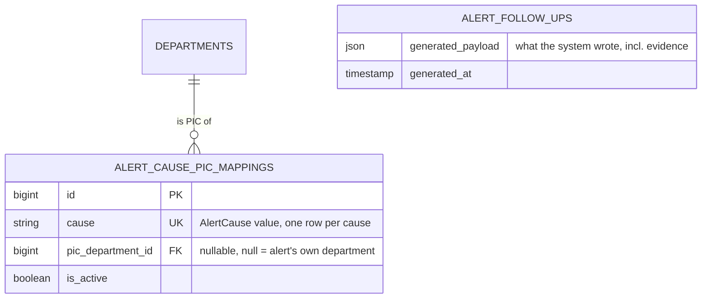

# Early Warning 5W2H Auto-Generator (E10-08)

## Overview

E10-08 makes the system write the whole 5W2H of an alert. `EarlyWarningFollowUpGenerator::generate()` reads the alert and the data around it, detects the likely **causes** with fixed rules, ranks them and fills What, Why, When, Where, Who, How and How much from per-cause templates. It is **rule-based and explainable**: no AI model, no external call, same input = same output, and every cause sentence cites the number it comes from. The result replaces the E10-06 baseline (Why, How and How much used to stay empty): the follow-up form on the alert detail page now opens with all seven fields filled and tagged "Dibuat sistem". Admins choose the PIC department of each cause in **Administration** (card "PIC per Penyebab").

## Architecture Diagram

```mermaid
flowchart TD
    S[EarlyWarningController@show] -->|suggestion closure| F[AlertFollowUpService::suggestionFor]
    SV[AlertFollowUpService::save - create only] --> F
    F --> G[EarlyWarningFollowUpGenerator::generate]
    G --> C[EarlyWarningService::alertContext - authorizes the section]
    G --> V[vitalsFor - volume / manpower change]
    G --> H[categoryBreakdown, topContributors, holidayShare, plannedVsActual]
    G --> K[costPerOvertimeHour]
    C --> D[detectCauses]
    V --> D
    H --> D
    D --> R[rankCauses: score desc, catalog order]
    R --> T[templates via __ - id / en]
    R --> W[resolveWhoDepartment]
    W --> M[(alert_cause_pic_mappings)]
    W --> U[User::alertRecipientsOf]
    T --> O[what / why / when / where / who / how / how much]
    K --> O
    O -->|suggestion prop| FORM[FollowUpForm.vue - tags Dibuat sistem / Diubah]
    O -->|first save only| P[(alert_follow_ups.generated_payload)]
```

## Data Model



Migration `create_alert_cause_pic_mappings_table`. `pic_department_id` is `nullOnDelete`, so deleting a department silently falls back to the own department. Nothing else changes in the schema: `generated_payload` already existed (E10-06) and now also carries `when_text`, `cost_note`, `primary_cause`, `supporting_causes` and `evidence` for audit.

### Generator output

| Key                                           | Meaning                                                                                                                        |
| --------------------------------------------- | ------------------------------------------------------------------------------------------------------------------------------ |
| `what`, `why`, `how`                          | Texts (`__()` with placeholders, locale of the user)                                                                           |
| `when_date`, `when_text`                      | Alert date and the streak as a range, e.g. `24–26 Okt 2026 (3 hari kerja berturut-turut)`                                      |
| `where`                                       | `Department — Section` (Q8: no production line in the data)                                                                    |
| `who_department_id`                           | PIC department (see _Who_)                                                                                                     |
| `how_much_hours`, `how_much_cost_idr`         | the month-to-date overspend (`excess_hours_per_day × follow_up_days`), and that × the cost of one overtime hour of the section |
| `cost_note`                                   | "Estimasi biaya belum tersedia" when hours exist but no cost basis does                                                        |
| `excess_hours_per_day`, `suggested_headcount` | Calculation inputs (`suggested_headcount` only when manpower is the primary cause)                                             |
| `primary_cause`, `supporting_causes`          | `AlertCause` values; supporting = next two by score                                                                            |
| `evidence`                                    | One entry per detected cause: code, score and the numbers it was detected from                                                 |

### Cause catalog and scoring

Thresholds live in `config/early_warning.php` (Q7: tuned at UAT). The **period** judged for the data causes is the `history_days` (7) calendar days ending on the alert date, widened to cover the whole streak.

| Cause                    | Detected when                                                             | Score                                                      |
| ------------------------ | ------------------------------------------------------------------------- | ---------------------------------------------------------- |
| `MANPOWER_SHORTAGE`      | volume change ≥ +10 % **and** manpower change ≤ 0 (both known)            | `gap / (100 + gap)`, `gap = volume − manpower` (heuristic) |
| `CATEGORY_DOMINANT`      | one category (Production / TPM / Project / Others) ≥ 50 % of period hours | the category share (0–1)                                   |
| `EMPLOYEE_CONCENTRATION` | top 3 employees ≥ 40 % of period hours, with at least 3 contributors      | the top-3 share (0–1)                                      |
| `HOLIDAY_OVERTIME`       | HLR hours ≥ 30 % of period hours                                          | the HLR share (0–1)                                        |
| `UNPLANNED_OVERTIME`     | actual hours exceed the **published** plan by ≥ 20 % (plan must exist)    | `(actual − plan) / actual`                                 |
| `UNKNOWN`                | nothing else detected                                                     | 0                                                          |

Highest score = primary (drives Who and How); the next two = supporting (only in Why). Equal scores keep the catalog order above. A detector whose data is missing is skipped, never guessed.

## Key Files & UI Mapping

| Layer          | File / Route / Menu                                                                                                                                       | Purpose                                                                                  |
| -------------- | --------------------------------------------------------------------------------------------------------------------------------------------------------- | ---------------------------------------------------------------------------------------- |
| Sidebar Menu   | _Early Warning_ → open an alert                                                                                                                           | The form under the chart opens with the generated 5W2H                                   |
| Sidebar Menu   | _Administration_ → tab _Policies_                                                                                                                         | Card "PIC per Penyebab" below the department limits                                      |
| Service        | `app/Services/EarlyWarningFollowUpGenerator.php`                                                                                                          | Pure generator (no HTTP / Inertia knowledge)                                             |
| Service        | `app/Services/EarlyWarningService.php` (`alertContext`, `categoryBreakdown`, `topContributors`, `holidayShare`, `plannedVsActual`, `costPerOvertimeHour`) | Alert + streak days and the read-only aggregates, constant number of queries             |
| Service        | `app/Services/AlertFollowUpService.php` (`suggestionFor`)                                                                                                 | Maps the generator output to the form shape; `save()` stores it as `generated_payload`   |
| Service        | `app/Services/AlertCauseMappingService.php`                                                                                                               | Lists (with defaults) and saves the mapping for Administration                           |
| Enum           | `app/Enums/AlertCause.php`                                                                                                                                | Six causes, `label()`, `description()`, `defaultPicKey()`, catalog order                 |
| Config         | `config/early_warning.php`                                                                                                                                | Thresholds, `shift_hours` 8, `follow_up_days` 7, `history_days` 7, default PIC codes     |
| Model          | `app/Models/AlertCausePicMapping.php` (+ factory, `AlertCausePicMappingSeeder`)                                                                           | `alert_cause_pic_mappings`                                                               |
| Model          | `app/Models/User.php` (`scopeAlertRecipientsOf`)                                                                                                          | Shared "who is notified" rule: send validation and the generator's Who check             |
| Controller     | `app/Http/Controllers/EarlyWarningController.php` (`show`)                                                                                                | `suggestion` is a closure prop (skipped by `only: [...]` reloads that do not ask for it) |
| Controller     | `app/Http/Controllers/Admin/AlertCauseMappingController.php`, `app/Http/Requests/Admin/StoreAlertCauseMappingRequest.php`                                 | `PUT /admin/alert-cause-mappings` (admin only)                                           |
| Page Component | `resources/js/pages/admin/Administration.vue`, `resources/js/components/admin/AlertCausePicCard.vue`                                                      | The "PIC per Penyebab" card                                                              |
| Page Component | `resources/js/components/early-warning/FollowUpForm.vue`, `resources/js/lib/earlyWarning.ts` (`FollowUpSuggestion`)                                       | Hints for When and cost; all eight inputs now tagged                                     |
| i18n           | `lang/id.json`, `lang/en.json`                                                                                                                            | Every template and label (kept in sync, sorted)                                          |
| Tests          | `tests/Unit/EarlyWarningFollowUpGeneratorTest.php`, `tests/Feature/AlertCauseMappingTest.php`, `tests/Feature/AlertFollowUpTest.php`                      | Rules, ranking, fallbacks, locale, scope, mapping, partial reloads                       |
| Browser tests  | `tests/Browser/EarlyWarning/FollowUpGeneratorBrowserTest.php`, `AlertFollowUpBrowserTest.php`                                                             | Prefilled + tagged form, edit / reset / send, admin picks a PIC                          |

## Flow Explanation

1. **User triggers** — opens an alert from **Early Warning**. `GET /early-warning/{section}/{date}` authorizes the section (another department = 403) and renders the page.
2. **Request handling** — `show` passes `suggestion` as a closure. A normal visit or `only: ['suggestion']` computes it; the save / send reload (`only: ['followUps', 'flash']`) does not.
3. **Business logic** — `suggestionFor()` calls `generate($user, $section, $date)`. `alertContext()` re-checks the scope and returns the alert plus the days of its streak. The generator loads vitals and the four aggregates, runs the detectors, ranks the causes and writes the texts.
    - **What**: zone, section, index, points above the zone limit, streak (same text as before).
    - **Why**: primary + up to two supporting causes, each with its number, joined by `;`.
    - **When**: alert date in the field, the streak range as a hint under it.
    - **Where**: department and section.
    - **Who**: admin mapping of the primary cause (row inactive or without PIC → own department; no row → configured default, e.g. `DEPT_HCM`, if that department exists). A department without active recipients is passed over when another candidate has some; if none has, the first candidate is kept and the send validation explains it.
    - **How**: the primary cause's template with its numbers, plus "Estimated need: N overtime hours (Rp …)" when the daily excess gave hours and a cost basis exists. Manpower: `max(1, ceil(excess / shift_hours))` people for `follow_up_days` working days.
    - **How much**: `excess_hours_per_day` = hours above the pace for the month so far (cumulative hours − hours expected by the alert date, never negative) ÷ `follow_up_days`; hours = that × `follow_up_days`, i.e. the overspend itself; cost = hours × the section's average cost per overtime hour (approved items' `total_cost_snapshot / total_hours` of the last 30 days, else the average effective hourly rate of the section's active employees, else 0 with `cost_note`).
4. **Response** — `FollowUpForm.vue` fills the fields and compares each against the suggestion: "Dibuat sistem" until edited, then "Diubah" with a reset link. On the first save `AlertFollowUpService::save()` stores the same output as `generated_payload` (server-side, outside the transaction; a client-sent payload is ignored).
5. **Administration** — an admin saves the six rows in one request; only suggestions generated afterwards change.

## API Endpoints & Routes

| Method | URI                           | Controller Action                          | Purpose                                 | Auth                 |
| ------ | ----------------------------- | ------------------------------------------ | --------------------------------------- | -------------------- |
| PUT    | `/admin/alert-cause-mappings` | `Admin\AlertCauseMappingController@update` | Save the cause → PIC department mapping | `auth`, `role:admin` |

`suggestion` is a prop of the existing `early-warning.show` route; no other route was added. The Wayfinder helper is `@/routes/admin/alert-cause-mappings` (`update`).

## Decisions & Trade-offs

- See [ADR-047](../decisions/047-early-warning-rule-based-follow-up-generator.md) for the main decisions.
- **`generate()` takes the user.** The epic's signature is `generate(Section, Carbon)`; the user is added so the generator cannot read another department's section even if a caller forgets the policy check (it resolves the alert through `alertContext()`).
- **Shares stand in for "share of excess hours".** The epic scores a cause by the share of the excess hours it explains. The data does not split excess hours by cause, so the share of the period's hours is the proxy; manpower uses a documented heuristic. Tuning is a UAT item (Q7).
- **Category-specific PIC is not modelled.** The catalog says "by category (TPM → maintenance)", but the plant has no maintenance department in the data and the mapping is per cause. `CATEGORY_DOMINANT` has one PIC; the category name is still in Why and How.
- **Reset uses the loaded suggestion.** The reset buttons restore from the `suggestion` already on the page (new follow-up) or from the saved snapshot (draft). The prop can be reloaded with `only: ['suggestion']`, but the form does not need to: the data cannot change within one page view in a way that matters.
- **When keeps one date.** The `when_date` column and input stay the alert date; the streak range is a read-only hint (`when_text`), not a second field.
- **Seeded defaults are optional.** Without a saved row the generator and the admin card both use the configured default code. The seeder only writes rows for dev data.
- **Rupiah always uses dots** (`Rp 7.500.000`) in generated text, in both locales; hours and percentages follow the locale's separators.

## Related

- [Early Warning 5W2H Follow-Up (E10-06)](./early-warning-follow-up.md)
- [Early Warning Alert Vitals (E10-05)](./early-warning-alert-vitals.md)
- [Early Warning Alert Detail Page (E10-04)](./early-warning-alert-detail.md)
- [ADR-045](../decisions/045-early-warning-follow-up-alert-link-and-suggestion-baseline.md), [ADR-047](../decisions/047-early-warning-rule-based-follow-up-generator.md)
- [Epic-10](../../scrum/Epic-10.md)
