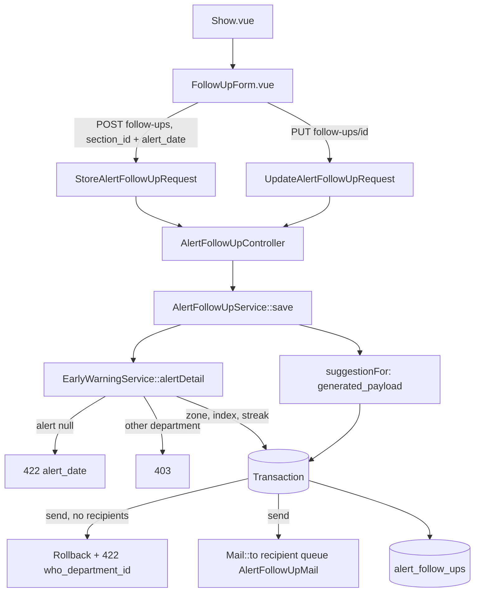
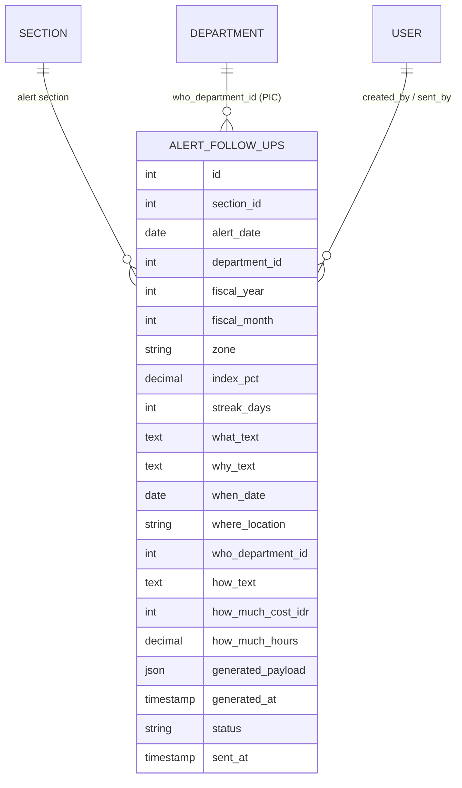

# Early Warning 5W2H Follow-Up Linked to an Alert (E10-06)

## Overview

E10-06 turns the month-level 5W2H follow-up into a follow-up of **one alert** (one section on one date). On the alert detail page the 5W2H form opens **prefilled with the system suggestion**; the user reviews it, edits any field, and either saves a **draft** or **sends** it by email to the PIC department ("Who"). Zone, index and streak are recomputed on the server at every save, a follow-up can only exist for a date that is an alert, an alert holds at most one draft, and a sent follow-up is read-only. The text the system generated is kept as a snapshot next to the user's final text (`generated_payload`), so the form can tag each field **"Dibuat sistem"** or **"Diubah"** and reset it. The Dashboard panel and its `dashboard.alert-follow-ups.*` routes are gone: the form lives only in the Early Warning module.

## Architecture Diagram

## Data Model

Columns added over E10-01 and E10-06: `alert_date`, `streak_days` (E10-01), `generated_payload` (JSON, nullable) and `generated_at` (E10-06). The E10-06 migration also **backfills legacy rows**: `alert_date` = the date the row was created on. The backfill runs in PHP (no vendor date functions), so it behaves the same on SQLite and MySQL/MariaDB. Legacy rows have no snapshot (`generated_payload = NULL`, no tags) and cannot be edited because they are not linked to a real alert (422).

`generated_payload` and the `suggestion` prop share one shape, keyed like the form: `what_text`, `why_text`, `when_date`, `where_location`, `who_department_id`, `how_text`, `how_much_cost_idr`, `how_much_hours`.

## Key Files & UI Mapping

| Layer          | File / Route / Menu                                                                         | Purpose                                                                                                          |
| -------------- | ------------------------------------------------------------------------------------------- | ---------------------------------------------------------------------------------------------------------------- |
| Sidebar Menu   | _Early Warning_ → alert row → follow-up form                                                | Inbox (1 click), alert detail (2), **Simpan Draft** / **Kirim via Email** (3). No new page or sidebar item.      |
| Page Component | `resources/js/pages/early-warning/Show.vue`                                                 | Passes `followUps`, `suggestion`, `departments` and `alert !== null` to the form                                 |
| Component      | `resources/js/components/early-warning/FollowUpForm.vue`                                    | The 5W2H form (moved from the Dashboard panel); status pill, history chips, tags, reset, save / send             |
| Component      | `resources/js/components/early-warning/FollowUpFieldTag.vue`                                | "Dibuat sistem" / "Diubah" tag and the per-field reset button                                                    |
| Types          | `resources/js/lib/earlyWarning.ts`                                                          | `FollowUpFields`, `WhoDepartmentOption`, `AlertFollowUpItem` (+ `is_editable`, `generated_payload`)              |
| Controller     | `app/Http/Controllers/AlertFollowUpController.php`                                          | `store` / `update`: thin, redirect back with the success toast                                                   |
| Controller     | `app/Http/Controllers/EarlyWarningController.php` (`show`)                                  | Adds the `suggestion` and `departments` props                                                                    |
| Service        | `app/Services/AlertFollowUpService.php`                                                     | `save()`, `suggestionFor()`, `recipientsFor()`, `listForAlert()`, `toPayload()`                                  |
| Request        | `app/Http/Requests/StoreAlertFollowUpRequest.php`, `UpdateAlertFollowUpRequest.php`         | `section_id` + `alert_date` required on create; update never accepts them; update checks the policy              |
| Policy         | `app/Policies/AlertFollowUpPolicy.php`                                                      | Unchanged: admin everywhere, others own department, sent = read-only                                             |
| Model          | `app/Models/AlertFollowUp.php`, `database/factories/AlertFollowUpFactory.php`               | `generated_payload` (array) and `generated_at` casts; `forAlert()` state                                         |
| Migration      | `database/migrations/2026_10_15_132911_add_generated_payload_to_alert_follow_ups_table.php` | New columns and legacy `alert_date` backfill                                                                     |
| Mail           | `app/Mail/AlertFollowUpMail.php`, `resources/views/mail/alert-follow-up.blade.php`          | Alert date, index, streak, 5W2H, Rupiah, sender and a link to the alert detail                                   |
| Tests          | `tests/Feature/AlertFollowUpTest.php`                                                       | 19 tests (save, snapshot, send, recipients, one draft, scope, legacy, suggestion prop, mail, migration backfill) |
| Browser tests  | `tests/Browser/EarlyWarning/AlertFollowUpBrowserTest.php`                                   | 5 tests (prefill + tags + reset + draft + send, new follow-up, validation, non-alert, Dashboard cleanup)         |

## Flow Explanation

1. **User opens an alert** — `EarlyWarningController@show` returns the alert, its follow-ups (newest first), the `suggestion` (`AlertFollowUpService::suggestionFor()`, `null` when the date is not an alert) and the active departments for the "Who" select.
2. **The form picks what to show** — the draft when one exists, otherwise the newest (sent) follow-up, otherwise a new form prefilled from the suggestion. **Tindak Lanjut Baru** appears when only sent follow-ups exist.
3. **Tags** — each field is compared with its baseline: the `generated_payload` of the shown follow-up, or the `suggestion` for a new one. Equal = "Dibuat sistem", different = "Diubah" (with a reset button, drafts only). A field the system left empty has nothing to compare with and carries no tag. **Reset semua ke saran sistem** restores every field that has a suggestion.
4. **Save / send** — `POST /early-warning/follow-ups` (new) or `PUT /early-warning/follow-ups/{alertFollowUp}` (draft), Inertia partial reload `only: ['followUps', 'flash']`. After the response the saved follow-up stays on screen: a new draft becomes the one edited next; a sent one stays read-only as confirmation.
5. **`AlertFollowUpService::save()`**
    1. A sent follow-up is refused (`status` error; the policy already answers 403 on the route).
    2. The target alert is the follow-up's own section and date (update) or the request's (create). `EarlyWarningService::alertDetail()` recomputes it and enforces the department scope (another department = 403).
    3. No alert on that date = 422 on `alert_date`, nothing written.
    4. In one transaction: create refuses a second draft for the alert (row lock, 422 on `status`); update re-reads the row `FOR UPDATE` and re-checks it is not sent (a double click cannot send twice). Zone, index and streak come from the recomputed alert; `generated_payload` and `generated_at` are written **only on create** and computed on the server (a client value is ignored).
    5. Send: at least one active admin / manager / team leader with an email in the Who department, otherwise 422 on `who_department_id` and the transaction rolls back. Then status = `sent`, `sent_by`, `sent_at` (WIB).
    6. After the commit, one `Mail::to($recipient)->queue(new AlertFollowUpMail($followUp))` per recipient.
6. **Email** — subject `[SMARTIME] Tindak Lanjut Alert <zone> — <section>`; body with section, date (`d/m/Y`), zone, index %, streak, the 5W2H table, `Rp 7.500.000` and hours, sender, sent time in WIB and a button to `route('early-warning.show', [section, date])`. A legacy row without a link opens the inbox instead.

## API Endpoints & Routes

| Method | URI                                         | Name                              | Controller Action                | Auth                                           |
| ------ | ------------------------------------------- | --------------------------------- | -------------------------------- | ---------------------------------------------- |
| POST   | `/early-warning/follow-ups`                 | `early-warning.follow-ups.store`  | `AlertFollowUpController@store`  | auth, verified, role admin/manager/team_leader |
| PUT    | `/early-warning/follow-ups/{alertFollowUp}` | `early-warning.follow-ups.update` | `AlertFollowUpController@update` | auth, verified, role admin/manager/team_leader |

The old `dashboard.alert-follow-ups.store` / `.update` routes were removed (they are replaced, not aliased).

| Response                             | Condition                                                                                |
| ------------------------------------ | ---------------------------------------------------------------------------------------- |
| 302 back + `success` flash           | Draft saved, or sent and queued                                                          |
| 302 back + `alert_date` error        | The date is not an alert (any more), or the follow-up is a legacy row that is not linked |
| 302 back + `status` error            | The alert already has a draft (create), or the follow-up was sent in the meantime        |
| 302 back + `who_department_id` error | Send with no active recipient in the Who department (nothing saved or queued)            |
| 302 back + field errors              | What missing (always); Why, When, Who, How missing on send                               |
| 403                                  | Operator, another department's section or follow-up, or a sent follow-up                 |

## Decisions & Trade-offs

- **Suggestion baseline until E10-08.** The system generator (E10-08) is not built. The form still must not open empty, so `suggestionFor()` writes the parts the alert data fully justifies: **What** (index, zone, points above the limit, streak), **When** (the alert date), **Where** (department — section) and **Who** (the alert's own department, the fallback of E10-08). **Why**, **How** and **How much** stay empty rather than guessed (no fabricated numbers). The shape equals the future generator's output, so E10-08 only replaces the body of `suggestionFor()`. See [ADR-045](../decisions/045-early-warning-follow-up-alert-link-and-suggestion-baseline.md).
- **Snapshot is recomputed on the server.** The client never sends `generated_payload`; storing a client copy would make "Diubah" meaningless. The cost is that the suggestion can change between opening the form and the first save; the stored snapshot is the one at save time.
- **Dashboard panel removed here, not in E10-07.** Moving the form and replacing the routes (both in this story) leave the Dashboard panel with nothing to post to, so it is removed now, together with the `alertFollowUps` prop and the `DashboardController` loading. E10-07 keeps the entry link and its own checks.
- **One draft per alert is enforced in code, not by a unique index.** Sent follow-ups share the same section and date, so a partial unique index would need DDL that differs per driver. The check runs inside the transaction with a row lock.
- **A non-alert date blocks drafts too.** An existing draft whose date turned Hijau cannot be saved or sent (422). The page already disables the form for a non-alert; the server says the same.
- **`AlertFollowUpSummary` folded in.** The read-only block of E10-04 is replaced by the form itself: a sent follow-up is the same form, disabled.

## Related

- [Early Warning Alert Detail Page (E10-04)](./early-warning-alert-detail.md)
- [Early Warning Alert Detection (E10-01)](./early-warning-alert-detection.md)
- [ADR-045](../decisions/045-early-warning-follow-up-alert-link-and-suggestion-baseline.md)
- [Early Warning Follow-Up Guide](../../user-docs/guides/early-warning-follow-up.md)
- [Epic-10](../../scrum/Epic-10.md)
