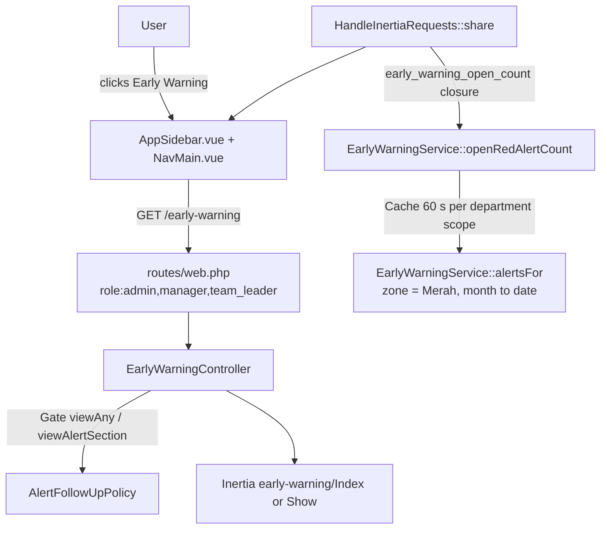

# Early Warning Menu, Routes & Authorization (E10-02)

## Overview

E10-02 gives the Early Warning module its entry point: one sidebar item (**Early Warning**, group _Operations & Overtime_), two routes (inbox and alert detail) and the authorization around them. Only Admin, Manager and Team Leader can reach the module; non-admins are limited to their own department on the server. The menu can carry a badge with the number of **open Merah alerts** of the current month. The pages themselves are minimal shells in this story: the inbox content arrives with E10-03 and the detail content with E10-04.

## Architecture Diagram

## Data Model

No schema change. The badge reads alerts computed by `EarlyWarningService` (E10-01) and follow-up status from `alert_follow_ups`.

## Key Files & UI Mapping

| Layer         | File / Route / Menu                                                          | Purpose                                                                                       |
| ------------- | ---------------------------------------------------------------------------- | --------------------------------------------------------------------------------------------- |
| Sidebar Menu  | _Early Warning_ (`data-test="nav-early-warning"`)                            | Entry point, after _Employee Reports_ in _Operations & Overtime_; `BellRing` icon             |
| Sidebar badge | `nav-early-warning-badge` (expanded) / `nav-early-warning-dot` (collapsed)   | Open Merah alert count, `99+` above 99, hidden when 0                                         |
| Routes        | `early-warning.index`, `early-warning.show` in `routes/web.php`              | Inbox and alert detail, behind `role:admin,manager,team_leader`                               |
| Controller    | `app/Http/Controllers/EarlyWarningController.php`                            | Thin: authorize, validate the date, render                                                    |
| Policy        | `app/Policies/AlertFollowUpPolicy.php` (`viewAny`, `viewAlertSection`)       | Department-scope rule shared with follow-up `view` / `update` through `canAccessDepartment()` |
| Service       | `app/Services/EarlyWarningService.php` (`openRedAlertCount()`)               | Badge count, cached per scope                                                                 |
| Shared prop   | `app/Http/Middleware/HandleInertiaRequests.php` (`early_warning_open_count`) | Lazy closure, skipped on partial reloads that do not request it                               |
| Nav component | `resources/js/components/NavMain.vue`                                        | `matchChildren` active state, badge and collapsed-mode dot                                    |
| Nav type      | `resources/js/types/navigation.ts` (`NavItem.matchChildren`)                 | Highlights the item on every page below its URL                                               |
| Page shells   | `resources/js/pages/early-warning/Index.vue`, `Show.vue`                     | Placeholders filled by E10-03 / E10-04                                                        |
| Wayfinder     | `resources/js/routes/early-warning/index.ts` (generated, git-ignored)        | `index()` used by the sidebar; regenerate with `php artisan wayfinder:generate --with-form`   |
| i18n          | `lang/id.json`, `lang/en.json`                                               | `Early Warning` and page strings                                                              |
| Tests         | `tests/Feature/EarlyWarningAccessTest.php`                                   | 11 tests: roles, scope isolation, date validation, badge scope and status rules               |
| Browser tests | `tests/Browser/EarlyWarning/EarlyWarningNavigationBrowserTest.php`           | 4 tests: sidebar entry, badge, active state on detail, collapsed dot, operator exclusion      |

## Flow Explanation

1. **User triggers** — a Manager clicks _Early Warning_ in the sidebar. The item exists only for admin, manager and team leader (`AppSidebar.vue`).
2. **Request handling** — `role:admin,manager,team_leader` rejects operators with 403. `index` then calls `Gate::authorize('viewAny', AlertFollowUp::class)`.
3. **Alert detail** — `show` resolves `{section}` by route model binding (unknown id is 404), authorizes `viewAlertSection` (another department is 403, checked **before** the date so an invalid date never reveals a foreign section) and validates `{date}` as `Y-m-d`. An invalid date redirects to the inbox with an `error` flash.
4. **Badge** — `HandleInertiaRequests` shares `early_warning_open_count` as a closure. It calls `openRedAlertCount()`, which returns 0 for roles that cannot see alerts, otherwise `alertsFor(month start, today, zone = Merah)` filtered to alerts whose latest follow-up is not `sent`. A draft keeps the alert open.
5. **Response** — the sidebar shows the count; when the sidebar is collapsed the number is hidden and a red dot is shown instead.

## API Endpoints & Routes

| Method | URI                               | Name                  | Controller Action              | Auth                                           |
| ------ | --------------------------------- | --------------------- | ------------------------------ | ---------------------------------------------- |
| GET    | `/early-warning`                  | `early-warning.index` | `EarlyWarningController@index` | auth, verified, role admin/manager/team_leader |
| GET    | `/early-warning/{section}/{date}` | `early-warning.show`  | `EarlyWarningController@show`  | same, plus own department unless admin         |

| Response                             | Condition                                                               |
| ------------------------------------ | ----------------------------------------------------------------------- |
| 403                                  | Operator, non-admin on another department, manager without a department |
| 404                                  | Unknown section id                                                      |
| 302 to `early-warning.index` + flash | Date is not a valid `Y-m-d` (e.g. `2026-02-31`)                         |

## Decisions & Trade-offs

- **Policy method instead of a new gate.** `viewAlertSection(User, Section)` lives on `AlertFollowUpPolicy` so the department rule exists once (`canAccessDepartment()`); `view` and `update` of follow-ups use the same helper. `EarlyWarningService::alertDetail()` keeps its own check as a second line of defence.
- **Badge is computed, cached for 60 seconds.** The "open Merah" count needs the daily index, which cannot be a single SQL aggregate. The count therefore reuses `alertsFor()` (constant number of queries) and is cached per scope (`all` for admins, department id otherwise) per Jakarta day. After sending a follow-up the badge can lag by up to 60 seconds. See [ADR-041](../decisions/041-early-warning-sidebar-badge-and-authorization.md).
- **Closure shared prop.** Inertia only evaluates it on full visits and on partial reloads that ask for it, so follow-up saves (`only: ['followUps','flash']`) do not recompute it.
- **Prefix highlighting via `matchChildren`.** `isCurrentUrl` is an exact match, so `/early-warning/{section}/{date}` would not highlight the item. The trailing slash in the prefix check stops `/early-warning-archive` from matching.
- **Placeholder pages.** The routes must exist for the sidebar and authorization to be testable; the Navigation Footprint of the epic (2 pages) is respected. E10-03 / E10-04 replace the shells.
- **Operators.** They never receive the badge prop value other than 0 and the menu is not rendered for them.

## Related

- [Early Warning Alert Detection (E10-01)](./early-warning-alert-detection.md)
- [Foundation Layout & Wayfinder Navigation](./foundation-layout-wayfinder.md)
- [Authentication & Role-Based Access Control](./authentication-rbac.md)
- [ADR-041](../decisions/041-early-warning-sidebar-badge-and-authorization.md)
- [Epic-10](../../scrum/Epic-10.md)
